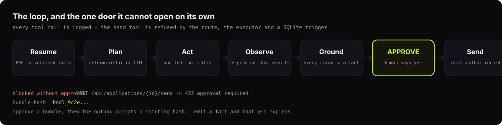
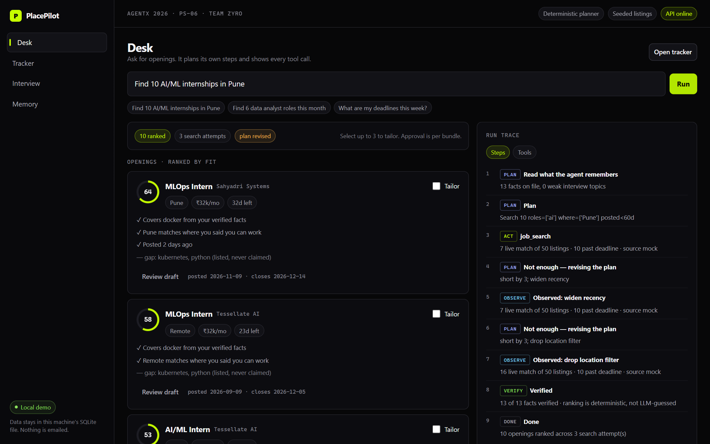
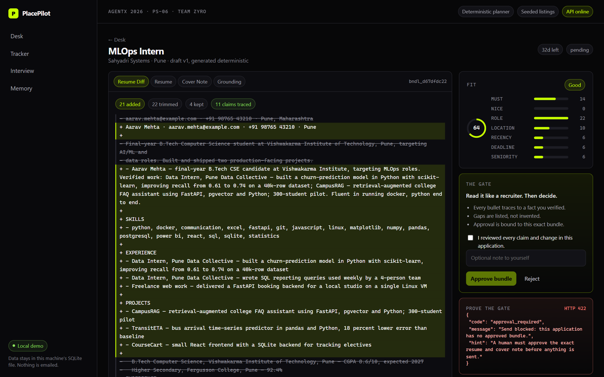
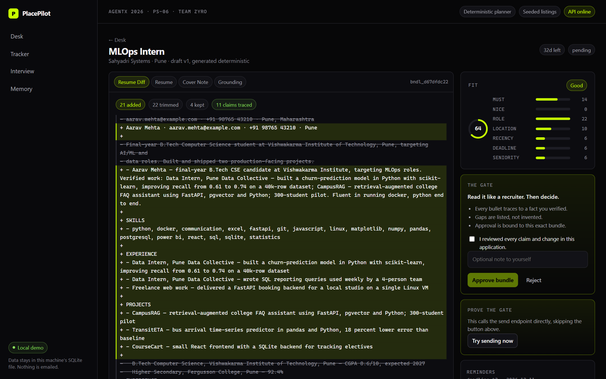
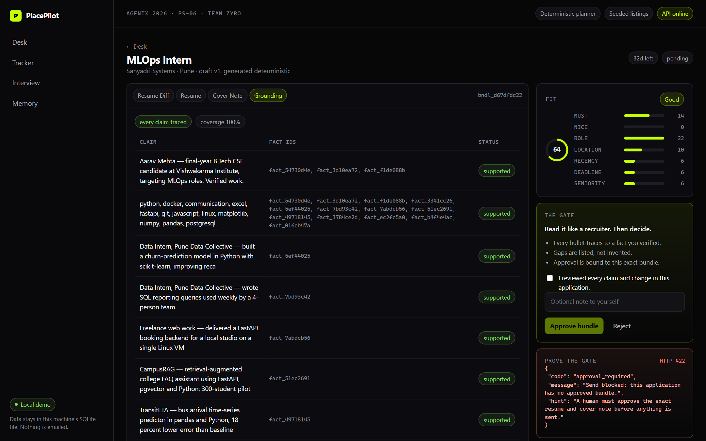
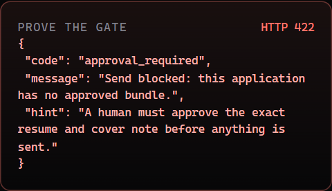

<div align="center">


<br>

**Students blast one generic resume at hundreds of openings and walk into interviews unprepared.**
**PlacePilot does the searching, tailoring and coaching — and refuses to send anything until you say yes.**

<br>


[](docs/tutorial.mp4)

</div>

<br>

> **The hard part isn't the AI. It's proving the AI can't act without you.**
> Every other "AI applies for you" tool trusts a prompt to behave. PlacePilot makes the refusal structural:
> the send endpoint returns **HTTP 422**, the agent's own tool executor refuses, and a **SQLite trigger**
> rejects the insert even if both layers are bypassed. Three independent locks, each with a test.

<br>

## 🎬 See it move

<div align="center">

</div>

That is a **captured** run, not a mock-up — regenerate it any time with `python scripts/capture_trace.py`.
The agent found 7 matches, judged that too few, widened its own search, and landed 10. Every step is a row in `run_events`.

<br>

## 🚪 The one door it cannot open alone

<div align="center">

</div>

<br>

## ⚡ The 30-second pitch

| | |
|---|---|
| **Who it's for** | Final-year students applying to dozens of internships with no mentor to tailor or rehearse with |
| **What it does** | Parses your resume into **verified facts** → searches openings → scores fit with named gaps → writes a tailored resume + cover note **using only those facts** → tracks deadlines → runs scored mock interviews that **remember your weak topics** |
| **What makes it different** | It **asks first**. An approval is cryptographically bound to one exact document bundle. Edit a fact afterwards and your old yes expires (`409 approval_stale`) |
| **The honesty bit** | If a job wants Kubernetes and it isn't in your verified facts, it appears under **"Deliberately not claimed"** — it never gets written into the document |

<br>

## 🆚 Before / after

<table>
<tr>
<th width="50%">❌ The usual approach</th>
<th width="50%">✅ PlacePilot</th>
</tr>
<tr>
<td valign="top">

One generic resume, sent to 200 openings. No idea which ones fit. Deadlines missed in a browser tab graveyard. A "mock interview" is a friend asking three questions. An AI tool is trusted to "send applications for you" because a prompt says please.

</td>
<td valign="top">

Resume → **13 verified facts** you can uncheck one by one. Search → ranked with a **score breakdown you can argue with**. Tailor → a **line diff** against your base resume. Send → **blocked at 422** until you approve that exact bundle. Practice → **scored by topic**, and weak ones **reopen next session with the score that put them there**.

</td>
</tr>
</table>

<br>

## 🖼️ Screens

<table>
<tr>
<td width="50%"><br><sub><b>Desk</b> — plan → act → observe → <i>re-plan</i> → verify, with every tool call logged</sub></td>
<td width="50%"><br><sub><b>Review</b> — the bundle, the diff, and a send that the server refuses</sub></td>
</tr>
<tr>
<td width="50%"><br><sub><b>Diff</b> — what changed, and what was deliberately left out</sub></td>
<td width="50%"><br><sub><b>Grounding</b> — every claim mapped back to the fact it came from</sub></td>
</tr>
</table>

<div align="center">

<br>
<sub>The refusal itself. Not a disabled button — the endpoint answering.</sub>
</div>

<br>

## 🚀 Quickstart

Three commands. **No API keys, no network, no accounts.**

```powershell
# 1 — dependencies (uv: venv's ensurepip is broken on this machine)
uv venv apps\api\.venv --python "C:\Users\sidde\AppData\Local\Programs\Python\Python313\python.exe"
uv pip install --python apps\api\.venv\Scripts\python.exe -r apps\api\requirements.txt
npm --prefix apps\web install

# 2 — sample resume PDF + start both servers
cd apps\api; .\.venv\Scripts\python.exe -m app.sample; cd ..\..
.\scripts\dev.ps1
```

```text
# 3 — open it
http://127.0.0.1:3210
```

Default ports are **:8010** (API) and **:3210** (web) because something else on this machine owns :3000/:8000. Override with `$env:PLACEPILOT_API_PORT` / `$env:PLACEPILOT_WEB_PORT`.

<br>

## 🧪 Verify it yourself

```powershell
cd apps\api; .\.venv\Scripts\python.exe -m pytest     # 39 passed
npm --prefix apps\web run build                       # typecheck + production build
node scripts\e2e.mjs                                  # 13-step golden path + 17 screenshots
node scripts\qa.mjs                                   # overflow / contrast / tap targets, 6 pages × 3 viewports
```

The test suite is **offline-locked**: it strips provider keys and fails loudly if anything tries a real network call. You cannot accidentally bill yourself by running tests.

<br>

<details>
<summary><b>🔒 The three-layer approval gate (and the exact tests)</b></summary>

<br>

Every send must pass three independent checks. Bypassing the UI does nothing; bypassing the route does nothing.

| # | Layer | What it does | Test |
|---|---|---|---|
| 1 | **Route** — `POST /api/applications/{id}/send` | No approved bundle → `422 approval_required` | `test_send_is_blocked_with_422_until_approved` |
| 2 | **Agent tool** — `Toolkit.send_application` | Same guard, so an LLM planning a send hits it too | `test_llm_send_attempt_still_blocked_by_approval` |
| 3 | **Database** — `outbox_needs_approval` trigger | `RAISE(ABORT)` unless an `approved` approval with a matching `bundle_hash` exists | `test_database_trigger_blocks_unapproved_insert` |

```sql
-- apps/api/app/db.py — the last line of defence
CREATE TRIGGER outbox_needs_approval BEFORE INSERT ON outbox
BEGIN
  SELECT RAISE(ABORT, 'approval_required')
  WHERE NOT EXISTS (
    SELECT 1 FROM approvals a
    WHERE a.id = NEW.approval_id AND a.application_id = NEW.application_id
      AND a.status = 'approved' AND a.bundle_hash = NEW.bundle_hash);
END;
```

**Why a hash, not a boolean?** So a yes is bound to *content*, not to a moment. The bundle hash covers the student, the job, the verified-facts hash, and both document hashes:

```
bundle_hash = sha256(student_id, job_id, facts_hash, resume_hash, cover_hash)
```

Regenerate the draft, edit a fact, or toggle verification and the hash moves — the old approval can no longer send, and the API answers `409 approval_stale` with `{approved, current}` so the UI can explain exactly what moved. Proven by `test_editing_a_fact_makes_an_approved_bundle_stale`.

</details>

<details>
<summary><b>🧠 How the agent actually plans (and why it can't lie)</b></summary>

<br>

**Deterministic planner (default).** The model-free path is the product: reproducible, free, and auditable.

```
load_memory → plan → search_jobs → observe → [re-plan if thin] → read_facts
            → score_fit → rank_jobs → verify → record_application → done
```

When results are thin it **relaxes exactly one constraint at a time**, and reports the delta each time:

| Attempt | Change | Matches |
|---|---|---|
| 1 | `roles=[ai] locations=[Pune] recency<60d` | 7 |
| 2 | widen recency → 90d | 7 |
| 3 | drop location filter | **16** |

No sleeps, no canned numbers — every observation string is computed from the rows returned.

**LLM planner (opt-in).** With a key configured, a real tool-use loop drives the same registry. It cannot exceed its powers: unknown tools are rejected, a failed call hands back to the deterministic planner mid-run with a visible `planner_fallback` event, and `send_application` is exposed but always guard-blocked.

**Grounding validator.** Tailoring may only use `verified=1` facts. The validator re-checks every number, proper noun and technology token in the output against those facts — anything unsupported fails the document, it cannot be approved, and the UI names the claim:

```json
{"passed": false, "problems": [{"claim": "kubernetes", "reason": "technology not present in verified facts"}]}
```

Proven by `test_grounding_rejects_skills_outside_facts`, including an adversarial case where a job demands Kubernetes/Tableau and the document must still not contain them.

</details>

<details>
<summary><b>🏗️ Architecture & data model</b></summary>

<br>

```
┌──────────────── Browser ────────────────┐
│ Next.js 15 App Router · design tokens   │
│ from the deck (#c6ff00 on #010101)      │
└──────────────┬──────────────────────────┘
               │ JSON · X-Student-Id · cursor polling
┌──────────────▼───────── FastAPI ────────────────┐
│ routers → services → domain (pure functions)    │
│ agent/ run manager · planner · tool executor    │
│ providers/ Adzuna · Anthropic · OpenRouter      │
└──────────────┬──────────────────────────────────┘
               │
        SQLite (WAL) + triggers
```

| Concern | Choice | Why |
|---|---|---|
| Storage | SQLite, one file | A student's data is theirs; one-click delete is a single `DELETE` cascade |
| Fit score | Deterministic, weighted, published | A score you can argue with beats a black box; no LLM in the ranking path |
| Agent trace | `run_events` + `tool_calls` | Every step is inspectable after the fact, including failures |
| Provider calls | One chokepoint (`providers.http_json`) | Tests swap it for a fake — no key, no network, no billing |
| Send | Local outbox, `record` only | A demo that emails strangers is worse than one that records honestly |

<details>
<summary>Tables (17)</summary>

`students` · `resumes` · `facts` · `jobs` · `applications` · `docs` · `approvals` · `outbox` · `reminders` · `interviews` · `questions` · `answers` · `topics` · `runs` · `run_events` · `tool_calls` · `memories`

Delete-all is verified to leave **zero rows** and **zero FK violations** — `test_delete_removes_every_row_for_the_student`.

</details>

</details>

<details>
<summary><b>🔌 Optional providers (Adzuna + OpenRouter / Anthropic)</b></summary>

<br>

Both are **real code, off by default, and tested through fakes**. Copy `apps/api/.env.example` to `apps/api/.env`:

```bash
# job listings
ADZUNA_APP_ID=...
ADZUNA_APP_KEY=...
ADZUNA_COUNTRY=in

# planner — either provider
OPENROUTER_API_KEY=sk-or-v1-...
# or
ANTHROPIC_API_KEY=sk-ant-...
PLACEPILOT_LLM=auto          # auto | off | anthropic | openrouter
# PLACEPILOT_MODEL=...
```

With `.env` present the API reports `planner=openrouter`, the UI badge flips from *Deterministic planner*, and live listings appear tagged `adzuna`. A provider failure **never fails the run**: it degrades to the seeded set and records the reason.

> **Honest status:** OpenRouter free models were exercised **live** (`planner=openrouter`, 3 ranked, gate still 422). Adzuna is covered by contract tests only — no app key was available, so no live round-trip happened. See [`docs/limitations.md`](docs/limitations.md).

Free models are rate-limited and rotate, so there is a **fallback chain** across them rather than one hardcoded id — that is why it survives a 429.

</details>

<details>
<summary><b>🎨 What is real, what is simulated</b></summary>

<br>

| Real | Simulated / clearly labelled |
|---|---|
| PDF parsing → facts → verification state | The 50 listings (fictional companies, `example.com` URLs) |
| Deterministic fit score + breakdown | "Sending" writes an immutable local row; **no email is dispatched** |
| Tailoring + grounding validator + diff | Interview scoring is rubric keyword coverage, not an LLM judge |
| Bundle hashing, approval state, staleness | Live Adzuna (no key available) |
| `422` + DB trigger | Hindi questions authored; scorer keywords are Hindi variants |

Interview scores are labelled in the UI: *"Score is rubric coverage, not fluency."* The fit score is a heuristic, not a hiring prediction.

</details>

<details>
<summary><b>📁 Repository layout & demo script</b></summary>

<br>

```
apps/api/app/     core.py (pure logic) · agent.py (loop) · providers.py · interview.py · main.py
apps/web/app/     landing · onboarding · desk · applications/[id] · tracker · interview · memory
scripts/          dev.ps1 · test.ps1 · e2e.mjs · qa.mjs · tutorial.mjs · capture_shots.mjs · make_assets.py
docs/             providers.md · limitations.md · deck-traceability.md · tutorial.md · screens/
```

**Three-minute demo:** Load sample → watch 13 facts appear → run *"Find 10 AI/ML internships in Pune"* → show the re-plan → tailor one → show **"Deliberately not claimed"** → *Try sending now* → **422** → approve → send → tracker → mock interview → **start another and watch the weak topics return** → Memory → **Delete all** → `Remaining: 0`.

A narrated 3-minute video is at [`docs/tutorial.mp4`](docs/tutorial.mp4).

</details>

<br>

## 🧭 Boundaries

- Single local student, no auth — identity is a browser-generated id; binding to `127.0.0.1` is the security boundary.
- Sending is `record` mode only. There is no SMTP switch to flip.
- Scanned/image PDFs are rejected with a clear error instead of guessed at.
- English UI; Hindi exists for interview questions.
- No deployment, no CI, no multi-worker serving — SQLite + one uvicorn worker is the intended shape.

<br>

<div align="center">
<sub><b>AgentX Hackathon 2026 · PS-06 · Team ZYRO</b> · Vishwakarma Institute of Technology, Pune · team code 79257B<br>
Gandharv Shinde · Swapnil Gangate · Atif Panhalkar · Siddesh Shirote</sub>
</div>
