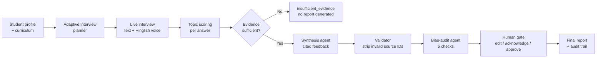

<div align="center">

# AgentX-ZYRO · Placement Co-pilot

### Interview practice in Hinglish, evidence-cited feedback, and a human in the loop


</div>

> **30-second pitch:** Placement season is stressful and uneven. Students get generic mock interviews, feedback that is vague or biased, and almost no practice in the language they actually think in. **Placement Co-pilot** runs adaptive technical interviews grounded in a student's real projects and coursework, can speak and switch between Hindi and English mid-sentence, and turns every session into a feedback report where **each claim points back to evidence**. Placement officers or mentors review the result before anything is final.

---

## Why this exists

| Problem | What the Co-pilot does about it |
| --- | --- |
| Mock interviews ask generic questions | Questions are built from the student's **own projects, tools and curriculum** |
| Feedback is vague ("be more confident") | Every point is **cited to a transcript turn** and ends in a concrete next step |
| Many students think in Hinglish, but tools force one language | **Native code-switched voice** so the interviewer sounds natural |
| Reviews can be biased or unsupported | An **independent audit pass** flags unsupported, vague, or single-source claims |
| AI verdicts nobody can challenge | **Nothing is final without a human** (mentor or placement cell) |

---

## Core ideas

1. **Grounded interviews.** Candidate profile and curriculum history drive an adaptive question planner that adjusts for junior, mid, and senior levels. Candidates can pause or skip a topic.
2. **Hinglish-native voice.** Text to speech uses one native code-switching call rather than splitting the sentence by language and stitching audio. In the LinguaSwitch experiment this was about 2.3× faster end to end (1234 ms vs 2521 ms time to first audio, 10 sentences).
3. **Evidence-cited reports.** Each strength, gap and recommendation carries source IDs. A deterministic validator strips any ID that does not exist and drops uncited claims.
4. **Independent bias audit.** A second agent, separate from the one that wrote the report, checks the draft for `unsupported_claim`, `recency_bias`, `single_source_bias`, `vague_language` and `contradiction`.
5. **Enforced human gate.** High-severity flags block approval at the API layer (HTTP 422) until a reviewer edits or acknowledges them. Every action lands in an audit log.
6. **Honest failure.** If the evidence is thin, the system says *"not enough data"* instead of inventing a review. If a provider fails, the error surfaces and nothing is silently faked.

---

## How it works



**Roles of each stage**

- **Planner** builds the topic list from the candidate's real missions and tools.
- **Interviewer** asks adaptive follow-ups and scores answer depth per topic.
- **Synthesis agent** writes the assessment with source IDs on every claim.
- **Validator (plain code)** means no model gets to invent its own evidence.
- **Bias-audit agent** judges the draft against the sources with fresh context.
- **Human gate** gives the final say to a person, with field-level diffs stored.

---

## Planned feature set

| Area | Feature | Status |
| --- | --- | --- |
| Interview | Adaptive, profile-grounded questions (junior / mid / senior) | Planned |
| Interview | Pause and skip a topic | Planned |
| Voice | Hinglish native code-switched TTS, blind A/B vs baseline | Planned |
| Voice | Streaming playback over WebSocket | Planned |
| Feedback | Evidence-cited report with strengths, gaps, next steps | Planned |
| Feedback | Printable report | Planned |
| Fairness | Independent bias audit with 5 flag types | Planned |
| Fairness | Evidence gate before generation | Planned |
| Governance | Human approval gate, HTTP 422 on unresolved high flags | Planned |
| Governance | Immutable audit log with field-level diffs | Planned |
| Recruiter / mentor | History, filters, notes, hire / hold decisions | Planned |
| Ops | Offline mock mode and deterministic LLM fallback | Planned |

> Update the Status column as features land. Keep every number in this README tied to a real measured run.

---

## Proposed stack

| Layer | Technology | Responsibility |
| --- | --- | --- |
| Frontend | Next.js, React, Tailwind | Interview room, feedback view, review dashboard |
| Backend | FastAPI, Pydantic | Interview lifecycle, scoring, approval API |
| LLM | OpenRouter, then local Ollama, then offline fallback | Question generation and synthesis |
| Audit | Second, independent model pass | Bias and evidence checks |
| Voice | Rime Coda for native Hinglish TTS, Groq for routing in baseline | Spoken interviewer |
| Storage | SQLite for local dev, Supabase Postgres for production | Sessions, reports, decisions, audit log |
| Hosting | Vercel (frontend), Render (backend) | Public demo |

---

## Repository map (target layout)

```text
backend/          FastAPI app: interview routes, planner, interviewer,
                  feedback, llm_client (fallback chain), session_store
frontend/         Next.js app: landing, interview, feedback, review dashboard
prompts/          Synthesis and bias-audit prompts
data/             Seed candidates, mock reports, sentence sets
scripts/          Smoke tests, eval runners, export helpers
tests/            Offline pytest suite and frontend type / build checks
docs/             Diagrams and screenshots
```

---

## Quick start

```bash
# 1. Backend
python -m pip install -r requirements.txt
cp .env.example .env        # set OPENROUTER_API_KEY, and voice keys if used
python main.py              # http://localhost:8000

# 2. Frontend
cd frontend
npm install
npm run dev                 # http://localhost:3000
```

No keys? Run the offline stack with deterministic mocks so nothing is billed:

```bash
MOCK_TTS=1 MOCK_LLM=1 python main.py
```

On Windows PowerShell, use `npm.cmd run dev` if script execution is restricted.

### Verify

```bash
python -m pytest tests/
cd frontend && npm run typecheck && npm run build
```

---

## API sketch

| Method | Endpoint | Purpose |
| --- | --- | --- |
| `POST` | `/api/interview` | Start, continue (`message`), or skip (`action: "skip"`) an interview |
| `GET` | `/api/candidates` | Candidate picker data |
| `GET` | `/api/interviews` | Mentor / placement-cell history |
| `GET` | `/api/interviews/{sessionId}` | Full report and transcript |
| `PATCH` | `/api/interviews/{sessionId}/review` | Save decision and reviewer note |
| `POST` | `/api/speak` | Hinglish speech for a given text |
| `GET` | `/health` | Liveness |

Errors are explicit, for example `502 {error, provider, fallback: "none"}`. Failures are never faked.

---

## Honest limitations

- Scores and bias flags are **advisory**. A reviewer can acknowledge a flag and proceed, and that acknowledgment is recorded permanently.
- Early evaluation will use a **small sample**; report raw counts, not claims of proof.
- Demo data is synthetic. Do not load real student data without consent, retention and access-control policies.
- Free-tier hosting sleeps when idle, so the first request can take 30–60 seconds.
- Network and provider latency vary run to run.

## Privacy

Candidate data and interview history stay in the local database in development. Never commit `.env` or the `.db` file.

---

## Inspiration and prior work

This project combines ideas proven in three earlier builds:

| Project | What we reuse |
| --- | --- |
| [LinguaSwitch](https://github.com/Siddesh-bype/LinguaSwitch) | Native Hinglish code-switching TTS, A/B latency eval, offline mock mode, honesty guards |
| [Bias-Aware 360° Review System](https://github.com/satyamshrivastav955-dotcom/bias-aware-360-review-system) | Cited claims, independent bias-audit agent, evidence gate, enforced human approval, audit trail |
| [ProbeIQ](https://github.com/Siddesh-bype/ProbeIQ) | Adaptive profile-grounded interviews, per-topic scoring, recruiter review workspace, LLM fallback chain |

## AI-assistance disclosure

Parts of this repository's scaffolding and documentation are drafted with Claude Code (Anthropic). Design decisions, test data, and all measured results should come from the team's own runs.

---

<div align="center">

Built for **AgentX · ZYRO**

<sub>Grounded questions · cited feedback · bias checked · nothing final without a human</sub>

</div>
